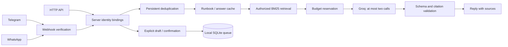

# Architecture

LeanDesk is a single-process support controller. eve hosts the channels; public support requests use the bounded controller rather than an extra free-running model session.

## Boundaries

`Runtime` resolves identity; request bodies cannot choose tenants or scopes. `Knowledge` filters records before scoring. `SupportAgent` owns case state, tool admission and budgets. `GroqProvider` handles deadlines, payload limits and reported usage. Channels authenticate transport then use the same controller. The default eve session endpoint is disabled.

The only model tool is `search_knowledge`, with one short query and server-supplied identity. No shell, browser, account mutation or ticket creation tool is exposed. Each retrieval keeps at most three authorized sections, discarding scores below 55% of the best BM25 match. Context is a byte-bounded JSON array of `{id,text}` records; complete section text is retained, including safety instructions. Oversized sections are skipped rather than truncated. Only packed evidence IDs can be cited. Only ambiguous evidence advertises the search tool. The second completion must be final; invalid output causes handoff without regeneration. Citation IDs must be a nonempty subset of supplied evidence. Semantic entailment is not proven automatically.

The initial prompt includes each question/attempt once. A second retrieval sends only new sections; previously supplied IDs remain valid for final citation checks. At most three initial and three additional sections can reach the model. Cache matching normalizes NFC, Turkish case and whitespace only: punctuation, accents, case facts and permission boundaries remain significant. This is not fuzzy or cross-user caching.

Document term frequencies are indexed once per `Knowledge` instance. Per-query document frequency and average length use only authorized documents. BM25 scores and ranking are preserved, with query work linear in authorized documents times query terms rather than rescanning the corpus inside every document score. Another tenant's documents cannot influence those statistics. `scripts/efficiency.ts` records offline request bytes, mock call counts and warm retrieval timing; it makes no new live-token or production-quality claim.

## Rust search backend

The Rust crate in `rust-search/` compiles to a dependency-free, import-free WASM module. Each knowledge snapshot owns one persistent instance and an inverted index of numeric term IDs, document lengths and tenant/scope group IDs. Normalization is shared with TypeScript, so Unicode/Turkish tokenization does not diverge. Rust computes authorized-corpus IDF, scores matching postings only and retains a stable top-three ranking. This changes the algorithm as well as the implementation language.

`auto` selects Rust at 64 sections or more when a valid artifact is available; otherwise TypeScript remains available. Explicit `rust` fails on an absent, stale or corrupt artifact. `typescript` forces the reference implementation. Loading checks source and binary hashes and rejects all host imports. The artifact is read from `native/` relative to the service working directory; ship `native/` and `rust-search/` with the repository deployment, alongside `knowledge/`. Node runs WASM directly, without per-query IPC or a native platform addon.

Input is a bounded u32 buffer with checked index parsing and no unsafe Rust. Every query supplies the authorized group IDs from server-owned principal bindings. Ranking statistics never mix tenants. Up to 256 MiB WASM linear memory and eight million input words are permitted; this pilot is not an unbounded search service. JS term-frequency maps are released after a Rust index loads, while query vocabulary/group maps remain available. Construction still tokenizes the source once and adds WASM indexing work. Benchmarks report construction separately from warm queries and include the host bridge.

`tests/rust-search.test.ts` compares actual WASM with TypeScript across Turkish queries, permissions, limits, stable ties, independent snapshots and malformed inputs. CI also forces all support-agent tests through the rebuilt Rust backend. `evidence/rust-search.json` is a synthetic local search benchmark, not evidence of faster Groq inference or lower billed tokens.

## Persistence and delivery

SQLite WAL stores redacted case facts, cached answers, events, delivery marks, tickets and per-owner metrics. Cases expire logically after 24 hours, drafts after 30 minutes and answer cache after 15 minutes. Expiration does not physically erase historical rows; automatic retention purge is not implemented.

Owner keys hash tenant, user ID and sorted scopes. Approved identity bindings can share an active case between channels. Scope changes produce a different owner/cache namespace. Event keys include transport identity and original conversation/message IDs.

In-process queues serialize case turns and delivery. Results are persisted before posting. An ordinary send failure retries the saved answer without another generation. A crash after platform acceptance but before marking delivery may duplicate a message; exactly-once external delivery is not claimed. Multiple application workers need shared locking and storage redesign.

## Cost accounting

The rolling call-budget probe is a prepared SQLite `SUM(calls)` over a partial covering index on `(owner, created, calls)` for positive call counts. It keeps the original strict `created > now - 24 hours` boundary and reads committed records on every check. Zero-call local events stay in the audit history without expanding this index. No application counter cache can become stale. A transactional additive migration backfills the numeric field once from historical usage JSON; new writes validate nonnegative safe integers and store JSON plus the count in one row. The benchmark in `scripts/bench-budget.ts` compares the previous JSON scan with this exact query; it does not measure provider latency or token savings.

Actual provider input/output tokens and cached input are recorded. Local answer-cache hits differ from provider prompt-cache discounts. Missing usage is recorded as an unreported call and blocks further model work for that case. Errors are not silently recorded as successful zero-cost completions.

Byte caps, output reservation, case usage and rolling daily call counts are checked before requests. Bytes are a conservative proxy, not an exact tokenizer. No automatic retry, critic model, embedding service or LLM summarizer is used.

## Administration

`AdminConsole` serves the buildless `admin/` assets and `/admin/api/*` routes through the same Node/eve runtime. Separate server-configured admin credentials bind each administrator to one tenant. In-memory opaque sessions last eight hours, are capped at 256, use HttpOnly/SameSite cookies and a per-session CSRF secret. Mutations require an exact Origin match. TLS deployments must configure the external origin and Secure cookie option. Support bearer tokens do not grant administrator access.

Tenant access is computed from current server identity bindings; hashed owner keys are never supplied by the client. SQLite aggregates usage over those owners and the selected time window. Knowledge search uses the administrator's fixed tenant, ignoring any client request to override it. No model is called by the dashboard. Unknown provider usage stays visible separately from recorded token totals.

`admin_settings` stores per-tenant model pauses. The bounded controller checks this before provider calls, including the second tool completion; already-running requests are not cancelled. Cache rows now include an owner key through an additive migration. Ownerless legacy cache rows are left untouched by admin clearing. Draft approval remains exclusively the support user's command; admin ticket changes apply only between queued/resolved states. Every mutation and its audit record commit in one SQLite transaction. Audit history and pause state persist across restarts; admin sessions do not.

Assets use a restrictive same-origin CSP and no third-party assets. User/document content is rendered with DOM text nodes. The panel supplies bounded pilot views (50 newest tickets, 30 audit entries), not unbounded exports. Company SSO, administrator lifecycle management, distributed rate limits and retention controls remain production integration work.

## Verification and deployment

Offline tests cover control flow and adapter verification. Retrieval evaluation uses four synthetic queries. `evidence/live-groq.json` records real provider usage for two synthetic tasks and a local cache hit. Baseline usage was measured earlier in the same session and reused to avoid extra spend. This is not a production benchmark or a full live channel/tool-calling evaluation.

Node 24 and persistent writable disk are required. Edge runtimes and ephemeral serverless SQLite are unsuitable. Company deployment also needs SSO, reviewed knowledge ownership, backups, a retention policy, and an external ticket dispatcher if desired.
