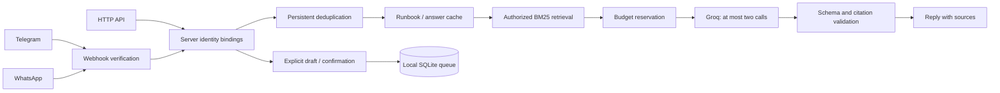

# Architecture

LeanDesk is a single-process support controller. eve hosts the channels; public support requests use the bounded controller rather than an extra free-running model session.

## Boundaries

`Runtime` resolves identity; request bodies cannot choose tenants or scopes. `Knowledge` filters records before scoring. `SupportAgent` owns case state, tool admission and budgets. `GroqProvider` handles deadlines, payload limits and reported usage. Channels authenticate transport then use the same controller. The default eve session endpoint is disabled.

The only model tool is `search_knowledge`, with one short query and server-supplied identity. No shell, browser, account mutation or ticket creation tool is exposed. Retrieval keeps at most three authorized sections, discarding scores below 55% of the best BM25 match. Context is byte-bounded JSONL. Only ambiguous evidence advertises the search tool. The second completion must be final; invalid output causes handoff without regeneration. Citation IDs must be a nonempty subset of supplied evidence. Semantic entailment is not proven automatically.

## Persistence and delivery

SQLite WAL stores redacted case facts, cached answers, events, delivery marks, tickets and per-owner metrics. Cases expire logically after 24 hours, drafts after 30 minutes and answer cache after 15 minutes. Expiration does not physically erase historical rows; automatic retention purge is not implemented.

Owner keys hash tenant, user ID and sorted scopes. Approved identity bindings can share an active case between channels. Scope changes produce a different owner/cache namespace. Event keys include transport identity and original conversation/message IDs.

In-process queues serialize case turns and delivery. Results are persisted before posting. An ordinary send failure retries the saved answer without another generation. A crash after platform acceptance but before marking delivery may duplicate a message; exactly-once external delivery is not claimed. Multiple application workers need shared locking and storage redesign.

## Cost accounting

Actual provider input/output tokens and cached input are recorded. Local answer-cache hits differ from provider prompt-cache discounts. Missing usage is recorded as an unreported call and blocks further model work for that case. Errors are not silently recorded as successful zero-cost completions.

Byte caps, output reservation, case usage and rolling daily call counts are checked before requests. Bytes are a conservative proxy, not an exact tokenizer. No automatic retry, critic model, embedding service or LLM summarizer is used.

## Verification and deployment

Offline tests cover control flow and adapter verification. Retrieval evaluation uses four synthetic queries. `evidence/live-groq.json` records real provider usage for two synthetic tasks and a local cache hit. Baseline usage was measured earlier in the same session and reused to avoid extra spend. This is not a production benchmark or a full live channel/tool-calling evaluation.

Node 24 and persistent writable disk are required. Edge runtimes and ephemeral serverless SQLite are unsuitable. Company deployment also needs SSO, reviewed knowledge ownership, backups, a retention policy, and an external ticket dispatcher if desired.
